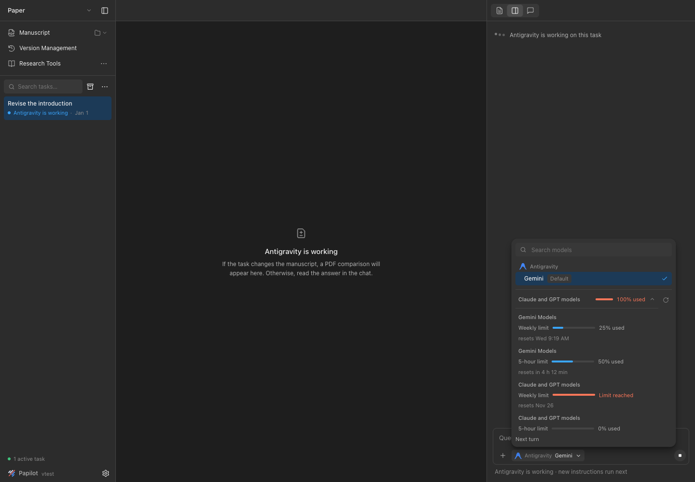
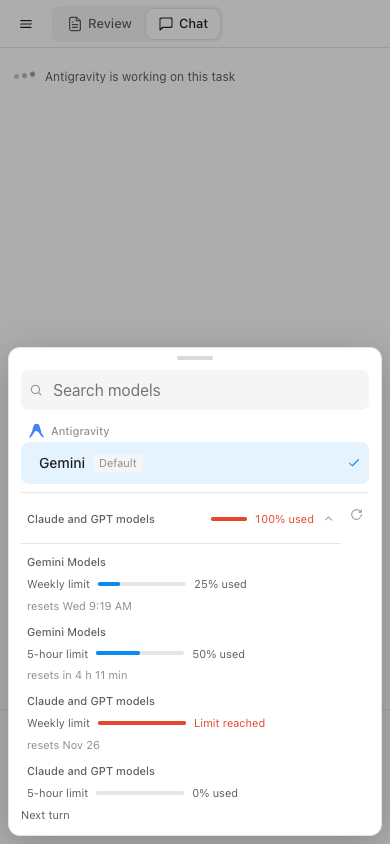

# Antigravity account quotas

Papilot reads `agy --print /usage --output-format json` through the same CLI
binary, environment and optional `PAPILOT_AGY_PROXY` as its Antigravity adapter.
The CLI owns authentication; Papilot does not read or copy Google credentials.

Verified on 2026-11-19 against the installed CLI and its connected account:
the command returned `status: "SUCCESS"`, an empty `conversation_id`,
`num_turns: 0`, and `command.name: "usage"`. No model turn was run.
`command.data.groups` contained separately named Gemini and Claude/GPT groups.
Each group's `buckets` provided `window: "5h"` or `"weekly"`, a
`remaining_fraction` and an RFC 3339 `reset_time`.

The [official usage documentation](https://antigravity.google/docs/cli/commands/usage/)
describes model groups sharing five-hour and weekly limits. The
[headless documentation](https://antigravity.google/docs/cli/headless/)
says to run built-in commands separately from the conversation event stream.
The sanitized fixture in `tests/fixtures/antigravity-usage.json` preserves the
observed structure, with deterministic example percentages.

Only the explicitly reported windows appear. Missing/invalid fractions and
amounts without a denominator are unavailable, not zero usage; disabled buckets
are omitted. Unknown window types retain the provider's name without assuming
a duration from their IDs or reset times. Every row carries its upstream model
group name, so an exhausted third-party limit is never attributed to Gemini.
The menu lists the account's reported groups without guessing model membership
from names or catalog order. No conversation token counts are used.

Both task composers expose quota details in the agent/model menu. Opening the
menu checks usage; it refreshes every minute while open and visible, and has a
manual refresh button. The adapter coalesces concurrent reads and caches results
for 30 seconds. Ending a turn invalidates the cache and notifies the workspace.
Quota reads time out after 20 seconds, fail independently of conversations, and
run in the background during Antigravity connection. Older CLIs without the
structured command response show `Usage not reported`.

Validation: `node --import tsx --test tests/antigravity-usage.test.ts`,
`node --import tsx scripts/check-antigravity-usage.mjs` (after `npm run build`). The browser
check covers new/existing tasks, mobile/desktop, light/dark, scoped exhaustion,
missing data and failed refreshes.

Screenshots use deterministic example quotas, not a connected account's data.

